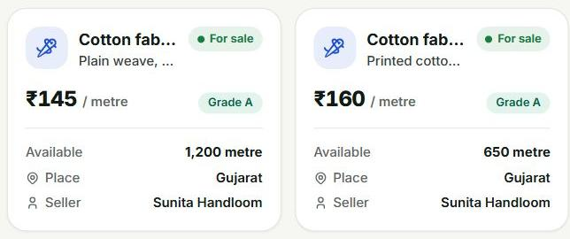

# YieldnYarn

YieldnYarn is an academic B2B marketplace for small agricultural and textile suppliers. Sellers publish stock and evidence photos from Android; buyers inspect approved lots, estimate prices, negotiate offers, and combine available supply into bulk orders.

Built by **Yash Raj (24BDS1209)** and **Aryan Raj (24BDS1094)** for Software Engineering, VIT Chennai.



## What it does

- Seller Android application with local drafts, photo evidence, retryable uploads, and offer responses.
- Buyer workspace for stock discovery, price estimates, requirements, negotiations, and order allocations.
- AI quality suggestions with a human verification queue and retained decision history.
- Configurable grading attributes, units, price adjustments, and quantity discounts for each vertical.
- Administrator tools for categories, users, reference prices, and complaints.
- English and Hindi web interfaces, in-app updates, and optional Firebase push.

## Architecture

```text
Next.js buyer / verifier / admin website ──┐
                                         ├── Django REST API ── PostgreSQL
Kotlin seller app (Room + WorkManager) ────┘          │                │
                                             FastAPI compute ────────┘
                                             grading / pricing / allocation
```

Django owns schema migrations and marketplace transactions. FastAPI reads the shared schema through SQLAlchemy and handles grading, estimates, and allocation. Configure `COMPUTE_INTERNAL_TOKEN` in both services to protect internal operations. Evidence uses shared local storage in Compose; Azure infrastructure definitions provide a cloud deployment path.

| Directory | Responsibility |
| --- | --- |
| `backend-django/` | Django REST Framework, JWT authentication, listings, offers, orders, permissions |
| `backend-fastapi/` | FastAPI grading, pricing, matching, scheduled price collection |
| `web-app/` | Next.js 16, React 19, TypeScript, Tailwind CSS |
| `seller-app/` | Kotlin, Jetpack Compose, Room, WorkManager |
| `ml-training/` | Training code, model checkpoints, evaluation reports |
| `infra/` | Local PostgreSQL and Azure Bicep infrastructure |
| `docs/` | API contracts, performance results, design and demonstration guides |
| `deliverables/` | Final report, earlier review, presentations, original lab submissions |

## Run with Docker Compose

Install Git and Docker with Compose. From the repository root:

```bash
cp .env.example .env
docker compose --profile app up -d --build
```

In PowerShell, use `Copy-Item .env.example .env` instead of `cp`. The first build downloads dependencies, including CPU inference libraries. Django migrates the database and seeds Agriculture and Textiles on startup. Create an administrator for your installation:

```bash
docker compose exec django python manage.py createsuperuser
```

| Service | Local address |
| --- | --- |
| Website | http://localhost:3000 |
| Marketplace API documentation | http://localhost:8000/api/docs/ |
| Compute health | http://localhost:8001/health |
| PostgreSQL | `localhost:5432` |

Set `DB_HOST_PORT` if port 5432 is occupied. Set `WITH_ML=false` to build without the inference dependencies. Stop services with `docker compose --profile app down`; database and evidence volumes remain available.

Compose defaults are for local development. Configure secret keys, the internal service token, allowed hosts, HTTPS, and secure cookies before exposing a deployment.

## Develop from source

Install Python, Node.js with pnpm, and PostgreSQL with PostGIS. Copy `.env.example` to `.env`, configure its database connection, then start the database with `docker compose up -d db` or use a local PostgreSQL instance. Use separate virtual environments for the Python services.

From `backend-django/`:

```bash
python -m pip install -r requirements.txt
python manage.py migrate
python manage.py seed_verticals
python manage.py createsuperuser
python manage.py runserver 127.0.0.1:8000
```

From `backend-fastapi/`, in another terminal:

```bash
python -m pip install -r requirements.txt
python -m pip install -r requirements-ml.txt --extra-index-url https://download.pytorch.org/whl/cpu
python -m uvicorn main:app --reload --port 8001
```

From `web-app/`:

```bash
pnpm install --frozen-lockfile
pnpm dev
```

See each component README for configuration. The prepared Windows presentation environment also has [startup helpers and walkthroughs](docs/demo/README.md).

## Seller Android application

Open `seller-app/` in Android Studio with the required Android SDK, or run:

```bash
cd seller-app
./gradlew :app:installDebug
```

Use `gradlew.bat` on Windows. The emulator reaches the host at `10.0.2.2`. For a physical device, configure a reachable host address using `-PsellerApiUrl=http://HOST:8000/api/` and `-PsellerComputeUrl=http://HOST:8001/compute/`, or use USB forwarding. See the [Android README](seller-app/README.md) for configuration and tests.

## Quality, prices, and allocation

MobileNetV3-Small checkpoints support wheat-kernel and fabric-patch analysis. Recorded validation balanced accuracy is approximately 58% for wheat and 57% for fabric. Confidence caps keep the current models below the automatic approval threshold, so their results require verifier review. Photos do not establish physical moisture content or GSM. See [model preparation and evaluation](ml-training/README.md).

Price estimates apply stored reference prices, grade multipliers, and quantity tiers. Local historical or manual records may be used; check their dates and sources. Allocation filters eligible active listings and takes cheaper stock first, retaining each seller's contribution to the order. Payments and carrier tracking are future integrations.

Optional integrations include Agmarknet collection through a configured `AGMARKNET_API_KEY` and Firebase push through backend credentials plus Android `google-services.json`. Keep private configuration outside version control.

## Validation

Run commands from the named component directory:

```bash
# backend-fastapi: pure calculation tests, no database required
python -m pytest tests/test_allocation.py tests/test_grade.py -q

# backend-django: PostgreSQL required
python manage.py test

# backend-fastapi: full suite requires the migrated database
python -m pytest

# web-app: unit tests, then browser integration with all services running
pnpm test
pnpm test:e2e
```

GitHub Actions includes backend, frontend, Android, API contract, and container workflows. Azure deployment runs through the manual workflow; see [Azure setup](infra/azure/README.md).

## Project documents

- [Final project report](deliverables/Project_Final_Report_Template.docx)
- [Review 1 report](deliverables/YieldnYarn_Review1_Report.docx)
- [Original diagram submissions](deliverables/ALL%20DIAGRAMS%20ETC/)
- [Project specification](docs/MSME_Marketplace_Project_Document.md)
- [Build plan](docs/MSME_Marketplace_Build_Plan.md)
